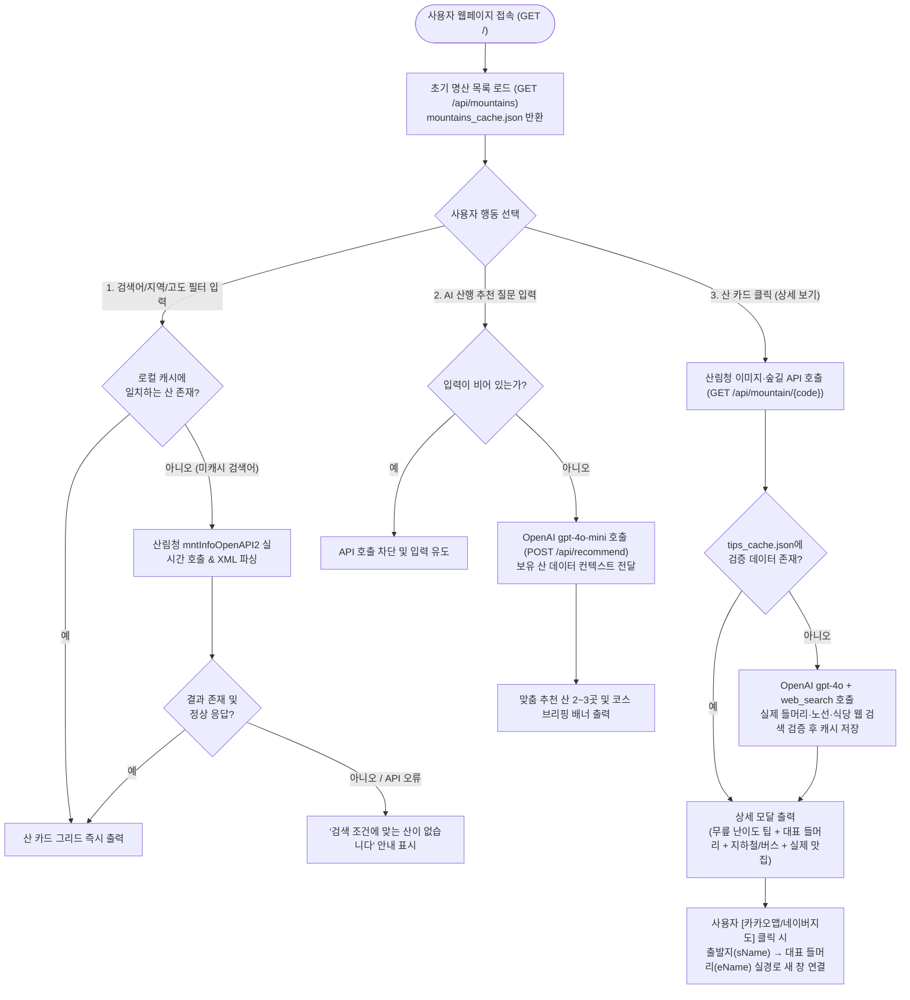

# 프로젝트 개요서 · 개발 계획서


---

## 1. 프로젝트명

**산림 큐레이터 (San Curator) — 60대 이상 시니어를 위한 맞춤형 AI 산행·교통·맛집 큐레이션 웹 서비스**

---

## 2. 한 줄 소개

“이 프로젝트는 **60대 이상 시니어 등산객**이 **산행지 선택부터 등산로 입구(들머리) 대중교통 확인, 하산 후 맛집 탐색까지 여러 앱을 오가며 겪는 불편과 AI 노선 환각 문제**를 해결하도록 **산림청 공공데이터 기반 맞춤 산 추천과 실시간 웹 검색 검증 교통·맛집 안내 기능**을 제공한다.”

---

## 3. 문제와 필요성

* **현재 어떤 불편이 있는가?**
  1. 시니어가 산행을 준비할 때 산 정보(고도·경사도), 대중교통(지하철역·버스 번호), 하산 후 식당 정보를 포털·지도·블로그에서 각각 따로 검색해야 한다.
  2. 기존 등산 앱은 젊은 층의 고강도 트레킹 위주여서 60대 이상에게 중요한 **무릎 부담도(계단 vs 완만한 흙길)** 정보를 한눈에 알기 어렵다.
  3. 일반 LLM에 대중교통 경로를 그냥 질문하면 존재하지 않는 지하철 호선이나 엉뚱한 버스 번호를 지어내는 **환각(Hallucination)** 문제가 발생하며, 지도 앱에 산 이름만 입력하면 등산로 입구가 아닌 '산 정상(봉우리)'이 목적지로 찍혀 길찾기가 실패한다.
* **지금은 그 문제를 어떻게 해결하고 있는가?**
  * 산악회 지인에게 물어보거나, 네이버 블로그 후기 여러 개를 일일이 읽고 카카오맵에서 등산로 입구 명칭을 다시 찾아 검색하고 있다.
* **이 프로젝트가 해결하려는 범위는 어디까지인가?**
  * 산림청 공공API(전국 4,705개 산, 2026.10 실측)와 사전 캐시 데이터로 산 정보·실물 사진·숲길 코스를 즉시 보여 주고, OpenAI 실시간 웹 검색(`web_search`)으로 검증된 **실제 들머리 명칭·지하철/버스 노선·실제 식당 상호**를 제공하며, 클릭 한 번으로 카카오맵·네이버지도의 **들머리 목적지 길찾기**로 연결하는 것까지를 핵심 범위로 한다.

---

## 4. 사용자와 사용 시나리오

* **주요 사용자**: 주말·평일에 대중교통(특히 지하철)을 이용해 배우자·친구·동창과 안전하게 산행하고 하산 후 식사를 즐기려는 **60대 이상 액티브 시니어**.
* **사용 상황**: 산행 전 집에서 자신의 체력과 지역에 맞는 완만한 산을 추천받고, 집 근처 역에서 등산로 입구까지 가는 교통편과 하산 후 들를 식당을 한 화면에서 확인하는 상황.
* **사용자 입력**:
  1. 자연어 산행 희망 조건 (예: *"60대 부부가 주말에 지하철 타고 가기 좋은 완만한 서울 근교 산 추천해줘"*)
  2. 지역(서울/경기/강원 등)·고도(500m 이하 등)·100대 명산 필터 또는 산 이름 검색어 (예: *"불암산"*, *"광교산"*)
  3. 출발 역 또는 동네 이름 (예: *"잠실역"*)
* **프로그램 결과**:
  1. 조건에 맞는 산 카드 목록 및 상세 정보(산림청 공식 풍경 사진, 등록된 숲길 구간, 관리기관 전화번호)
  2. AI 시니어 산행 브리핑 (무릎 부담도, 추천 완만 코스, 필수 준비물 3줄 요약)
  3. 실시간 웹 검색으로 검증된 **대표 들머리 명칭(예: 청계산 원터골입구)**, 도착 지하철역(호선·출구)·버스 번호, 하산 후 실제 맛집 리스트 및 **카카오맵·네이버지도 길찾기 직결 버튼**

---

## 5. 기능 목록 (필수 3개 이하 / 추가 / 제외)

| 우선순위 | 기능 | 설명 (필요 이유 및 난이도) | 완료 확인 방법 | 현재 상태 |
| :---: | :--- | :--- | :--- | :---: |
| **필수 1** | **산림청 OpenAPI 기반 산 탐색 및 하이브리드 검색** | • 주요 명산 107개(산림청 100대 명산 전체 포함) 로컬 JSON 캐시(`mountains_cache.json`)로 즉시 필터링(지역·고도·100대명산)하고, 미캐시 산 검색 시 산림청 API(`mntInfoOpenAPI2`) 실시간 호출<br>• 산 클릭 시 실물 사진(`mntInfoImgOpenAPI2`)과 숲길 구간(`frtrlSectnOpenAPI2`) 표시 *(난이도: 보통)* | 지역 필터 클릭 및 미캐시 산(`광교산`) 검색 시 산 정보·사진·숲길 구간이 화면에 정상 출력되는지 확인 | **1단계** |
| **필수 2** | **OpenAI 기반 시니어 맞춤 자연어 산행 추천** | • 시니어의 체력·동행자·계절 조건 입력 시 보유 산 데이터를 근거로 적합한 산 2~3곳과 추천 이유·코스를 안내 *(난이도: 보통)* | 자연어 질문 입력 시 보유 산 코드와 매칭되는 추천 결과문이 화면 배너에 표시되는지 확인 | **1단계** |
| **필수 3** | **웹 검색 검증 들머리 교통편·하산 맛집 안내 및 지도 직결** | • OpenAI `gpt-4o` + `web_search`로 실제 들머리 명칭·지하철역/버스·실제 식당을 검증해 환각을 방지하고 JSON 캐시(`tips_cache.json`)에 저장<br>• 들머리 명칭을 목적지(`eName`)로 하여 카카오맵·네이버지도 길찾기 연결 *(난이도: 보통)* | 산 상세 모달에서 실제 역·출구·식당 상호가 표시되고, 지도 버튼 클릭 시 산 정상이 아닌 '들머리 입구'로 길찾기가 열리는지 확인 | **1단계** |
| **추가 1** | **시니어 간편 한줄·태그 리뷰 공유** | • 로그인 없이 닉네임과 터치형 태그(`[화장실 깨끗함]`, `[계단 많음]`) 또는 한줄 평을 JSON/SQLite에 저장·공유 *(난이도: 낮음)* | 상세 모달에서 리뷰 등록 후 다시 열었을 때 등록한 리뷰가 목록에 유지되는지 확인 | **2단계** |
| **추가 2** | **시니어 주변 즐길거리 연계 (온천·전통시장)** | • 하산 후 피로를 풀 수 있는 인근 온천·족욕탕·전통시장 정보를 웹 검색 및 지도 링크로 제공 *(난이도: 낮음)* | 상세 모달 내 즐길거리 탭/버튼 클릭 시 주변 온천·전통시장 정보 및 지도가 표시되는지 확인 | **2단계** |
| **추가 3** | **큰 글씨(효도) 모드 및 음성 브리핑(TTS)** | • 상단 버튼으로 전체 글자 크기를 확대하고, 브라우저 음성 합성(`speechSynthesis`)으로 산행 브리핑을 읽어 주는 기능 *(난이도: 낮음)* | `[큰 글씨]` 클릭 시 폰트 확대, `[음성 듣기]` 클릭 시 안내 음성이 재생되는지 확인 | **3단계** |
| **제외** | **자체 회원제 DB · 자체 대중교통 라우팅 엔진** | • 복잡한 회원가입/로그인은 시니어 사용성을 해치며, 실시간 환승 시각 계산은 카카오맵·네이버지도 길찾기 직결로 대체 가능하므로 제외 | 해당 없음 (범위 제외) | **제외 확정** |

---

## 6. 자료와 기술

| 구분 | 사용할 자료·기술 | 사용 이유 | 필수/선택 | 준비 및 확인 상태 |
| :--- | :--- | :--- | :---: | :--- |
| **입력·캐시 자료** | • [mountains_cache.json](file:///c:/Users/kyboc/OneDrive/%EB%AC%B8%EC%84%9C/1%EA%B9%80%EC%98%81%EB%B3%B5/AI/ICT/mountains_cache.json) (명산 107개)<br>• [tips_cache.json](file:///c:/Users/kyboc/OneDrive/%EB%AC%B8%EC%84%9C/1%EA%B9%80%EC%98%81%EB%B3%B5/AI/ICT/tips_cache.json) (검증된 교통·맛집)<br>• 산림청 OpenAPI 가이드(`.docx`) | • 반복적인 외부 API 호출 지연 및 비용을 줄이고 0.1초 이내 빠른 화면 응답 제공 | 필수 | **준비 완료** |
| **공공 API** | • 산림청 산정보 OpenAPI v2<br>  - `mntInfoOpenAPI2` (산 목록·설명)<br>  - `mntInfoImgOpenAPI2` (산 이미지)<br>  - `frtrlSectnOpenAPI2` (숲길 구간) | • 국내 3,368개 산의 공식 고도, 소재지, 100대 명산 선정 이유, 실물 사진, 숲길 구간 확보 | 필수 | **키 발급 및 연동 완료**<br>*(일일 호출 한도 사전 확인 필요)* |
| **AI 모델·검색** | • OpenAI `gpt-4o-mini` (Chat Completions)<br>• OpenAI `gpt-4o` + `web_search` (Responses API) | • `gpt-4o-mini`: 보유 산 목록 기반 빠른 맞춤 산 추천<br>• `gpt-4o` + 웹 검색: AI 노선 환각 차단 및 실제 들머리·지하철·식당 팩트 검증 | 필수 | **키 설정(`.env`) 및 연동 완료**<br>*(웹 검색 호출당 과금 확인 필요)* |
| **검색·처리** | • Python 3.12 표준 라이브러리 (`urllib`, `xml.etree.ElementTree`, `json`, `os`)<br>• 예외 처리 (`try-except`) | • 불필요한 외부 패키지 없이 공공데이터 XML 파싱, JSON 직렬화, API 타임아웃/오류 방어 | 필수 | **구현 완료** |
| **화면·배포** | • Backend: `FastAPI`, `uvicorn`, `python-dotenv`<br>• Frontend: [static/index.html](file:///c:/Users/kyboc/OneDrive/%EB%AC%B8%EC%84%9C/1%EA%B9%80%EC%98%81%EB%B3%B5/AI/ICT/static/index.html) (Tailwind CSS, Lucide 아이콘, 카카오/네이버 지도 URL 연동) | • 단일 서버로 API와 반응형 웹 화면을 함께 서빙하여 실행과 시연을 단순화 | 필수 | **로컬 구동 확인 완료** (`http://localhost:8000`) |

---

## 7. 전체 처리 흐름



---

## 8. 개발 단계 (1인 프로젝트 기준)

| 단계 | 구현 내용 | 실행 입력 예시 | 정상 동작 확인 결과 (완료 기준) | 현재 상태 |
| :---: | :--- | :--- | :--- | :---: |
| **1** | **공공API 검증 및 기본 데이터 캐싱** | • 산림청 API에 `searchWrd=북한산`, `mntiListNo=113500101` 요청 | • HTTP 200 XML 응답 파싱 성공 및 주요 명산 107개(산림청 100대 명산 전체 포함) [mountains_cache.json](file:///c:/Users/kyboc/OneDrive/%EB%AC%B8%EC%84%9C/1%EA%B9%80%EC%98%81%EB%B3%B5/AI/ICT/mountains_cache.json) 생성 확인 | **1단계** |
| **2** | **기본 화면(UI) 및 조건별 산 검색·상세 연동** | • 지역 `서울`, `100대 명산` 체크 / 검색창에 `광교산` 입력 | • 서울 명산 3건 즉시 표시, 미캐시 산(`광교산`) 실시간 조회 표시, 상세 모달에서 사진·숲길 구간 출력 | **1단계** |
| **3** | **AI 자연어 추천 및 웹 검색 기반 교통·맛집 연동** | • 추천창: *"60대 부부 서울 근교 완만한 산"*<br>• 상세 모달: `청계산` + 출발지 `잠실역` | • 추천 산 브리핑 출력<br>• 들머리(`청계산 원터골입구`), 신분당선 청계산입구역 2번 출구, 실제 식당(`장수촌`) 출력 및 지도 직결 확인 | **1단계** |
| **4** | **시니어 추가 기능 (큰글씨·음성안내·한줄리뷰·즐길거리)** | • `[큰 글씨]` 토글, `[음성 듣기]` 클릭, 한줄 리뷰 등록 | • 글자 확대, TTS 음성 출력, 새로고침 후에도 리뷰 유지, 주변 온천·전통시장 검색 연결 | **2단계** |
| **5** | **예외 상황 전체 점검 및 최종 시연 준비** | • 빈 입력, 없는 산 이름(`없는산123`), 네트워크/API 오류 시뮬레이션 | • 서버 중단(500 에러) 없이 안내 문구가 화면에 정상 표시되고 시연 시나리오 전 과정 통과 | **3단계** |

---

## 9. 테스트 계획 및 실행 결과

> 가이드 원칙에 따라 **실제 실행하여 확인한 항목만 '통과'**로 기록하고, 아직 실행 전인 항목은 **'테스트 예정'**으로 구분합니다.

| 번호 | 테스트 항목 | 입력 · 상황 | 기대 결과 | 실제 결과 | 확인 상태 |
| :---: | :--- | :--- | :--- | :--- | :---: |
| **1** | **정상 요청 (조건 필터 조회)** | `region=서울`, `top100_only=true` | 서울 소재 100대 명산 목록 반환 | `북한산_백운대`, `관악산`, `도봉산_자운봉`, `청계산_매봉` 4건 반환 (청계산은 서울·경기 걸침) | **통과 (확인 완료)** |
| **2** | **정상 요청 (미캐시 산 실시간 폴백)** | 검색어 `q=광교산` 입력 | 캐시에 없으므로 산림청 API 실시간 호출 후 결과 반환 | 산림청 OpenAPI 통해 `광교산` 1건 정상 반환 | **통과 (확인 완료)** |
| **3** | **정상 요청 (산 상세·사진·숲길)** | `불암산(113500101)` 클릭 | 산 기본 정보 + 실물 이미지 + 숲길 구간 반환 | 불암산 정보, 이미지 3건, 숲길 10개 구간(`불암산 1구간` 등) 반환 | **통과 (확인 완료)** |
| **4** | **정상 요청 (AI 맞춤 산 추천)** | *"60대 부부가 주말에 지하철 타고 가기 좋은 완만한 서울 근교 산 추천해줘"* | 보유 산 데이터 중 적합한 산과 추천 이유·코스 응답 | `관악산(116200201)` 등 추천 이유와 완만 코스 설명 반환 | **통과 (확인 완료)** |
| **5** | **정상 요청 (웹 검증 교통·맛집)** | `청계산` 모달 오픈 (출발지: `잠실역`) | 가짜 환승 노선 없이 실제 들머리 역·출구·식당 상호 반환 및 지도 연결 | 들머리 `청계산 원터골입구`, `신분당선 청계산입구역 2번 출구 도보 700m`, 식당 `장수촌`·`한소반 청계산점` 반환 | **통과 (확인 완료)** |
| **6** | **빈 입력 예외 처리** | AI 추천 입력창을 비운 채 `[큐레이션 받기]` 클릭 | API를 호출하지 않고 실행 중단 | 프론트엔드 `if (!query) return;`으로 API 미호출 확인 | **통과 (확인 완료)** |
| **7** | **검색 결과 없음 처리** | 존재하지 않는 산 이름 `없는산999` 검색 | 빈 배열 반환 및 `"검색 조건에 맞는 산이 없습니다"` 화면 표시 | 산림청 API 0건 정상 응답, 브라우저에서 빈 상태 안내 문구 표시 확인 (2026-10-20 E2E) | **통과 (확인 완료)** |
| **8** | **API 오류 · 타임아웃 대응** | OpenAI 또는 산림청 API 네트워크 오류 발생 시 | 앱이 종료되지 않고 기본 안전 수칙 및 지도 길찾기 안내 문구 표시 | 자동 테스트로 산림청 타임아웃·OpenAI 오류·잘못된 응답 주입 → 모두 200 응답과 안내 문구 반환 (pytest 25건 통과, 2026-10-20) | **통과 (확인 완료)** |
| **9** | **추가 기능 (리뷰·즐길거리·TTS)** | 한줄 리뷰 등록, 주변 온천·장터 버튼, 큰글씨·음성듣기 실행 | 리뷰 저장·표시, 온천·장터 지도 연결, 음성 정상 재생 | 추가 기능 구현 후 테스트 수행 예정 | **테스트 예정** |
| **10** | **지역 필터 광역시 포함** | `경상·부산·대구·울산`, `전라·광주` 등 지역 버튼 | 광역시 소재 산(무등산·팔공산·금정산·마니산·가지산)도 해당 권역에 표시 | 33개 산 전부 한 개 이상 권역에 포함 (pytest) | **통과 (확인 완료)** |
| **11** | **특수문자·주입 방어** | 산 이름·맛집에 ``, `'` 포함 | 화면이 깨지지 않고 스크립트 미실행, 따옴표 상호도 지도 연결 | 브라우저 E2E에서 주입 미실행·지도 연결 확인 | **통과 (확인 완료)** |
| **12** | **연속 클릭 경쟁 상태** | 응답이 느린 산을 열고 바로 닫은 뒤 `청계산` 열기 | 이전 산의 늦은 응답이 청계산 정보를 덮어쓰지 않음 | 들머리 `청계산 원터골입구` 유지 확인 | **통과 (확인 완료)** |
| **13** | **카카오맵·네이버지도 들머리 직결** | `청계산` + 출발지 `잠실역` | `sName=잠실역&eName=청계산 원터골입구`로 두 지도 모두 연결 | 두 URL 모두 들머리 목적지로 생성 확인 | **통과 (확인 완료)** |
| **14** | **CDN 장애 대응** | 아이콘·스타일 CDN 차단 상태로 접속 | 아이콘 없이도 산 목록 정상 표시 | 차단 상태에서 33개 목록 표시 확인 | **통과 (확인 완료)** |

---

## 10. 제약과 주의사항 (예상 오류 및 대응 방법)

1. **AI 노선 환각(Hallucination) 위험과 대응**
   * **문제**: 일반 채팅 모델(`gpt-4o-mini`)은 출발지~목적지 대중교통 환승 노선(몇 호선, 몇 번 버스)을 그럴듯하게 지어내는 문제가 실제 검증에서 확인됨.
   * **대응**: 교통·맛집 안내에는 `gpt-4o`의 실시간 웹 검색(`web_search`)을 강제하여 검증된 들머리 역·버스만 표시하고, 출발지からの 실시간 환승 경로는 카카오맵/네이버지도 길찾기(`sName`→`eName=들머리명`)로 직결하여 오류 가능성을 원천 차단함.
2. **API 사용량·요금 및 응답 속도 제약**
   * **문제**: OpenAI `web_search`는 일반 텍스트 생성보다 응답 시간(약 5~10초)이 걸리고 호출당 비용이 발생함. 산림청 OpenAPI 역시 일일 트래픽 한도가 존재함.
   * **대응**: 한 번 조회된 산 목록([mountains_cache.json](file:///c:/Users/kyboc/OneDrive/%EB%AC%B8%EC%84%9C/1%EA%B9%80%EC%98%81%EB%B3%B5/AI/ICT/mountains_cache.json))과 웹 검색 검증 결과([tips_cache.json](file:///c:/Users/kyboc/OneDrive/%EB%AC%B8%EC%84%9C/1%EA%B9%80%EC%98%81%EB%B3%B5/AI/ICT/tips_cache.json))를 로컬 JSON 파일에 자동 저장하여, 동일 산 재조회 시 외부 API 호출 없이 **0.01초 만에 무료로 즉시 응답**하도록 구현함.
3. **공공데이터 문서와 실제 엔드포인트 차이 및 결측치**
   * **문제**: 산림청 가이드 문서(`.docx`)에는 오퍼레이션명이 `mntInfoOpenAPI`로 적혀 있으나 실제 서버는 `mntInfoOpenAPI2`만 동작하며, 일부 산은 높이(`0m`)나 이미지 데이터가 비어 있음.
   * **대응**: v2 엔드포인트(`*OpenAPI2`)를 적용 완료했으며, 이미지가 없는 산은 기본 산림 배경 이미지를 대체 표시하도록 예외 처리함.
4. **API 키 보안 관리**
   * **대응**: `OPENAI_API_KEY`와 `FOREST_API_KEY`는 코드에 하드코딩하지 않고 `.env` 환경변수 파일로 분리하고 `.gitignore`에 등록하여 외부 유출을 방지함.

---

## 11. 최종 결과와 시연 계획

* **완성할 프로그램**: 시니어 맞춤형 AI 산행·교통·맛집 큐레이션 반응형 웹 애플리케이션 ([main.py](file:///c:/Users/kyboc/OneDrive/%EB%AC%B8%EC%84%9C/1%EA%B9%80%EC%98%81%EB%B3%B5/AI/ICT/main.py) + [static/index.html](file:///c:/Users/kyboc/OneDrive/%EB%AC%B8%EC%84%9C/1%EA%B9%80%EC%98%81%EB%B3%B5/AI/ICT/static/index.html))
* **실행 방법 및 접속 주소**:
  ```bash
  py -3 -m uvicorn main:app --port 8000
  # 브라우저 접속: http://localhost:8000
  ```
* **발표에서 보여 줄 핵심 시연 시나리오 (3분)**:
  1. **[맞춤 추천]**: 메인 화면 AI 검색창에 *"60대 부부가 주말에 지하철로 갈 수 있는 완만한 서울 근교 산"*을 입력하여 AI 큐레이션 결과 확인.
  2. **[필터 및 실시간 검색]**: `서울 + 100대 명산` 필터로 산 카드를 좁혀 보고, 캐시에 없는 산(`광교산`)을 검색해 산림청 API 실시간 연동 확인.
  3. **[검증된 교통·맛집 및 지도 직결]**: `청계산` 카드를 클릭해 산림청 실물 사진·숲길 구간·무릎 난이도 브리핑을 보고, 출발지(`잠실역`) 입력 후 **검증된 들머리(`청계산 원터골입구`) 기준 카카오맵 대중교통 길찾기**와 **실제 맛집(`장수촌` 등) 지도 검색**이 새 창으로 정확히 열리는 과정 시연.
* **아직 구현하지 못한 기능과 이유**:
  * **사용자 한줄 리뷰 공유, 주변 온천·전통시장 즐길거리, 큰글씨·음성(TTS) 안내**: 핵심 필수 기능 3개와 교통편 웹 검색 팩트 검증을 우선 완성하였으며, 해당 3가지 기능은 4단계 추가 개발 단계에서 순차적으로 구현할 예정임.

---

## 12. 가이드 체크리스트 자체 점검

* [x] 문제와 사용자가 구체적으로 정해져 있는가? *(60대 이상 시니어의 산행·교통·맛집 파편화 및 노선 환각 문제)*
* [x] 기술 이름보다 사용자에게 제공할 결과가 먼저 설명되어 있는가? *(들머리 교통편·무릎 난이도·실제 맛집 결과 중심 서술)*
* [x] 필수 기능이 3개 이하로 제한되어 있고, 기본 기능부터 완성할 수 있는가? *(필수 기능 3개 제한 및 구현 완료)*
* [x] 필요한 JSON 자료나 API 키를 실제로 준비할 수 있는가? *(`.env` 키 2종 및 캐시 JSON 준비·연동 완료)*
* [x] 수업에서 배운 내용(파이썬, API·JSON, 예외 처리, OpenAI API, 웹 검색)으로 구현 가능한 범위인가? *(100% 부합)*
* [x] 기능마다 실행 결과로 확인할 완료 기준이 있는가? *(5번 및 8번 표에 명시)*
* [x] 자료 부족·API 오류·빈 입력에 대한 동작이 정해져 있는가? *(7번 흐름도 및 9번 테스트 표에 명시)*
* [x] 배포에 필요한 키와 설정을 코드에 직접 넣지 않는가? *(`.env` 및 `.gitignore` 분리 관리)*
* [x] LLM이 제안한 사실·라이브러리·API를 직접 확인했는가? *(산림청 `*OpenAPI2` 실제 호출 및 `web_search` 노선 정확도 직접 검증 완료)*
* [x] 확인하지 않은 기능을 이미 구현된 것처럼 적지 않았는가? *(추가 기능 3종 및 미실행 예외 테스트는 '예정'으로 명확히 구분)*

---

## 13. 정밀 검증 이력 (2026-10-20)

* **검증 방법**: ① 코드 정적 리뷰 → ② 데이터 정합성(캐시·마스터 DB·웹 사실 확인) → ③ 백엔드 자동 테스트(`tests/test_api.py`, 외부 API 모킹 25건) → ④ 외부 API 실호출(`verify_live.py`) → ⑤ 브라우저 E2E 20개 시나리오 → ⑥ 보안·시니어 사용성 점검
* **데이터 수정**
  * 동명이산 오류: 캐시의 `아차산`이 충남 보령 아차산(423.9m)이었으나 교통정보는 서울 기준 → 서울 광진구 아차산(`112150201`, 287m)으로 교체
  * `민둥산`: 캐시는 가평 민둥산, 교통정보는 정선 민둥산 기준이었고 정선 민둥산은 산림청 DB 미등록 → 목록에서 제외 (총 33개 → 광교산 추가 후 34개)
  * 인왕산 들머리 `호랑이동상` → `수성동계곡`(종로09 종점과 일치), 아차산 들머리 `광나루역 1번 출구 → 아차산생태공원`, 무등산 증심사 버스 노선(`봉선37` 오기) 수정
  * 마스터 DB 맛집 66곳 웹 검증: 확인 26 / 미확인 39 / 폐업 1 → 미확인·폐업 40곳 삭제, 들머리 인근 주소가 확인된 16곳 추가 (`verified: 2026-10-20` 표기). 맛집이 없는 7개 산은 메뉴별 지도 검색 버튼으로 안내
* **코드 수정**: 지역 필터 광역시 매핑, 높이 파싱 오류로 검색 결과 전체 유실, 미존재 코드 404 처리, 산 코드 주입 차단, 빈/과도한 AI 질문 서버측 차단, 출발지 변경 시 유료 웹검색 중복 호출 제거, 화면 HTML 주입 방어, 상세 창 경쟁 상태, CDN 장애 시 앱 멈춤, 카카오맵 길찾기 추가, 실행 경로 독립화
* **보안**: `main.py`에 하드코딩돼 있던 산림청 API 키 제거(`.env` 전용), `.gitignore` 보완. 기존 코드가 외부에 공유된 적이 있다면 키 재발급 권장
* **남은 과제**: 추가 기능(리뷰·즐길거리·큰글씨/TTS), 맛집 정보는 영업 변동이 있으므로 주기적 재검증(`verify_foods.py`), 청계산(116500601)은 산림청 사진·숲길 0건
* **추가 검증 (2026-10-20 오후, 실서비스 브라우저 점검)**
  * 상세 창 닫기: 화면 고정 '닫기' 버튼 + 하단 '안내 창 닫기' 버튼 추가
  * 지도 길찾기: 카카오맵·네이버지도 모두 **도착지(들머리 좌표)만 입력된 대중교통 길찾기**로 연결, 출발지는 지도에서 입력. 대표 명산 들머리 좌표를 카카오맵 장소로 수집(동명 장소 오매칭 3건 수정: 가지산 석남사→울주, 팔공산→동화사 주차장, 한라산→성판악탐방안내소)
  * AI 추천: 검증 데이터(들머리·교통·무릎 팁)만 근거로 사용, 마크다운·코드 번호 제거
  * 실시간 검색 산(광교산) 점검: AI 즉석 정보가 실행마다 달라지고 '직선 1.1km→도보 1.1km' 왜곡, '지하철 없음' 오류 확인 → 광교산을 출처 확인 후 검증 목록에 추가(34개). 비검증 산은 'AI 웹 검색 결과(방문 전 확인 권장)' 표시, 엉뚱한 기본 사진 제거
* **100대 명산 확장 (2026-10-20 저녁)**
  * 산림청 100대 명산 중 미등록 73개 추가 → 목록 107개(100대 명산 100개). 동명 산은 지역 표기(백운산(정선·광양·포천), 지리산(사량도), 남산(경주) 등)
  * 검증 절차: ① gpt-4o 웹검색으로 들머리·교통·시니어 팁·식당 후보 수집(`verify_top100.py`) → ② 카카오맵에서 들머리 장소·좌표 확인(소재지 시·군 일치, 주유소·해수욕장 등 오매칭 제거, 행정경계에 걸친 산 12곳 재검색) → ③ 식당은 카카오맵 등록 + 들머리와 같은 읍·면만 채택(최대 3곳, 카카오맵 장소 ID 연결) → ④ 교통은 출처 기반, 버스 번호 표본 5건(유명산 8005, 축령산 30-4, 비슬산 달성5, 조계산 순천1, 황악산 김천 11·111) 노선 자료와 일치 확인
  * 표시: 새 73개는 '지도 확인 정보 (버스 시간표는 방문 전 확인)', 기존 34개는 '사전 검증 정보'
  * 남은 한계: 교통 노선 미확인 12곳(지도 길찾기 안내), 들머리 주변 식당 미확인 5곳(덕항산·방장산·운장산·태화산·황장산), 산림청 사진 없음 10곳
* **AI 큐레이션 조건 오류 수정 (2026-10-20)**
  * 증상: '충청남도 가을 단풍 100대 명산 3곳' → 안내문에 전북 내장산·비100대 덕산이 나오고, 카드는 덕항산·삼악산(안내문과 불일치)
  * 원인: 107개 전체를 AI에 넘겨 조건 판단을 맡김, 안내문과 산 코드를 AI가 따로 작성
  * 수정: 서버가 질문에서 지역(시·도/권역/서울 근교)·100대 명산·완만(800m 이하) 조건을 먼저 적용해 후보를 거름 → AI는 후보 번호만 선택 → 서버가 후보 검증 후 안내문과 카드를 같은 데이터로 생성(조건을 안내문 첫 줄에 표시)
  * 검증: 자동 테스트 30건 통과, 실서비스 질문 6종 모두 조건 일치·안내문=카드 확인

